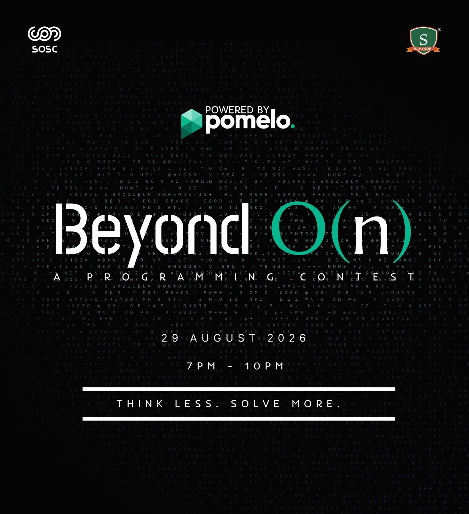

_Think less. Solve more._

Beyond O(n) was a programming contest that introduced **Pomelo**, SOSC's very own competitive programming platform: self-hosted, open source, and built by the community for contests like this one.

An evening of coding, logic, and problem-solving challenges, with a little friendly chaos as participants raced against the clock and each other.

## Event Details

- **Date:** 29th August 2026
- **Time:** 7:00 pm - 10:00 pm
- **Where:** Online, on Pomelo (the contest link was shared on the day)
- **Prizes:** Exciting goodies for the top 3 winners

## Media

