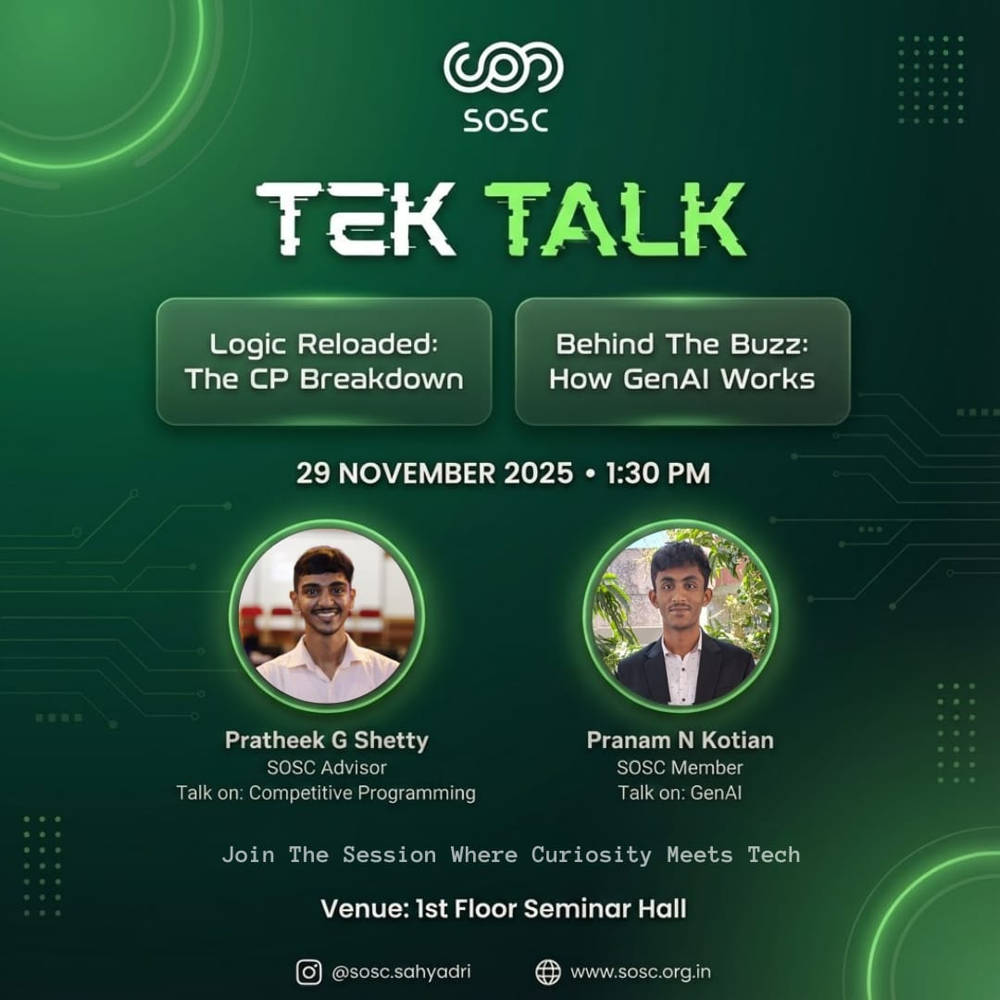

_Join the session where curiosity meets tech._

A concise, thought-provoking session for students who want to understand the "why" behind technology, not just the "how."

## Sessions

#### Logic Reloaded: The CP Breakdown

- **Speaker:** Pratheek G Shetty, SOSC Advisor
- **Topic:** Competitive Programming

#### Behind the Buzz: How GenAI Works

- **Speaker:** Pranam N Kotian, SOSC Member
- **Topic:** Generative AI

## Event Details

- **Date:** 29th November 2025
- **Time:** 1:30 pm
- **Venue:** 1st Floor Seminar Hall

## Post-Event Report

"Behind the Buzz: How GenAI Works" introduced students to the rapidly evolving landscape of Generative AI. The talk began with the fundamentals of modern AI, breaking down key terminology and concepts to show how GenAI systems work behind the scenes. Topics included the evolution from rule-based systems to today's data-driven approaches, along with simplified explanations of machine learning, deep learning architectures, transformers, multimodal models, and how text is processed through tokenization and embeddings.

The session stayed interactive throughout. Students listened attentively and responded actively during the questionnaire, and clear explanations with relatable examples helped them grasp complex topics with ease.

Overall, the session was well received and highly informative for first- and second-year students, sparking interest in AI and encouraging them to explore the broader potential of GenAI.

## Media

